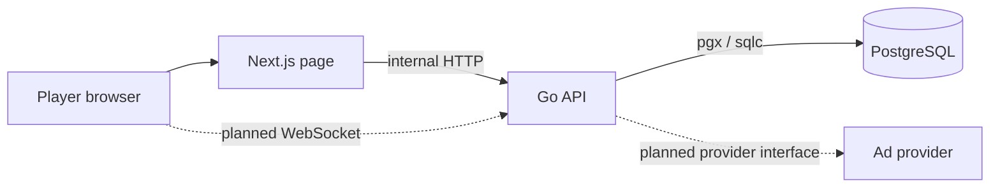
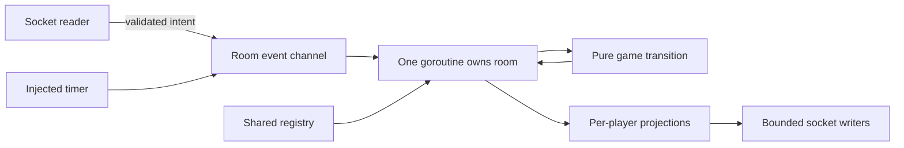
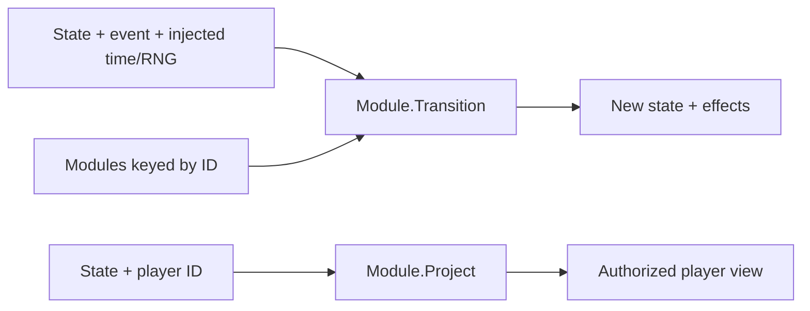
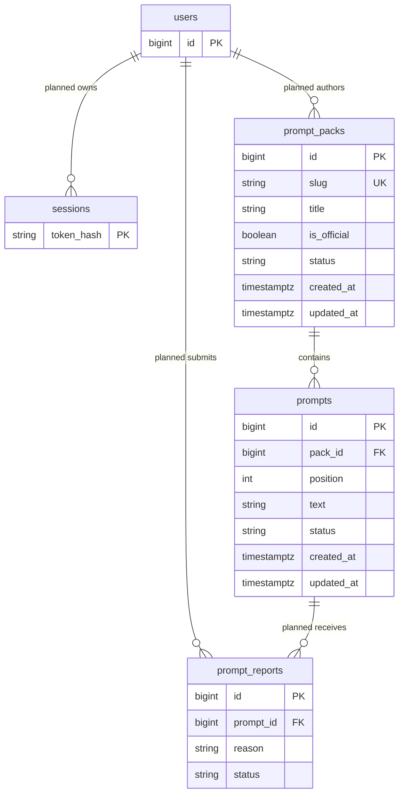

# Architecture

Implemented in M0: PostgreSQL migrations, generated store, JSON seed, two read-only HTTP
endpoints, status page. Everything labeled planned is a design direction, not shipped code.

## System context

No host screen. Each participant eventually renders shared state and personal controls.
Browser URLs use localhost; service-to-service URLs use Docker DNS. Current server-rendered
page fetches /healthz and /api/packs without a browser CORS dependency.

## Room actor flow — planned

The registry is the sole shared mutable room coordination point. Never perform network I/O
inside pure rules; effects are interpreted by the room runtime. Bound queues and writes.

## Join flow including AdGate — planned
```mermaid
sequenceDiagram
  participant P as Player
  participant A as Platform API
  participant G as AdGate provider
  participant R as Room actor
  P->>A: Join code + optional reconnect token
  A->>A: Validate origin, code, limits and capacity
  A->>G: Check consent / admission policy
  G-->>P: Mock first; ad if eligible later
  P->>A: Admission completion
  A->>R: Join intent
  R-->>P: Session token + authorized projection
```
M1 joins directly; M6 inserts AdGate, never during a round. Server validates admission;
client success claims are not authority. Reconnect policy is decided before M1.

## Game module — interface stub only; lifecycle planned

`backend/internal/games` holds only this contract and an unimplemented registry signature.
Wit Parade is an empty placeholder. No game engine is implemented.
Protocol convention: JSON `{type, id?, payload}`, snake_case types, camelCase fields.
Go protocol package is authoritative; frontend lib/protocol.ts mirrors it. No messages yet.

## Data model
prompt_packs/prompts exist now; users, sessions, prompt_reports and ownership FKs are planned.

Published official packs are exposed publicly. Prompt approval and account ownership arrive
in M3–M5; current constraints allow draft/published packs and pending/approved/rejected prompts.
Room/session reconnect tokens are separate from future account sessions. Live rooms are in
memory for v1 (planned), not database records. See deployment plan for scaling implications.
