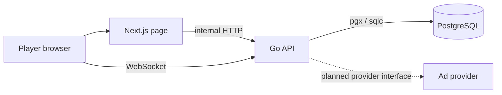
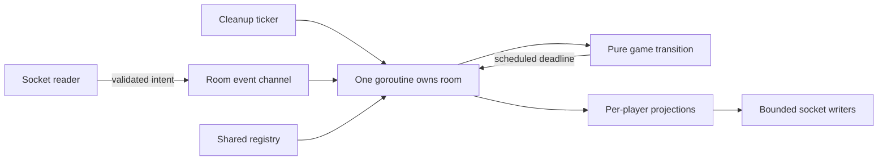
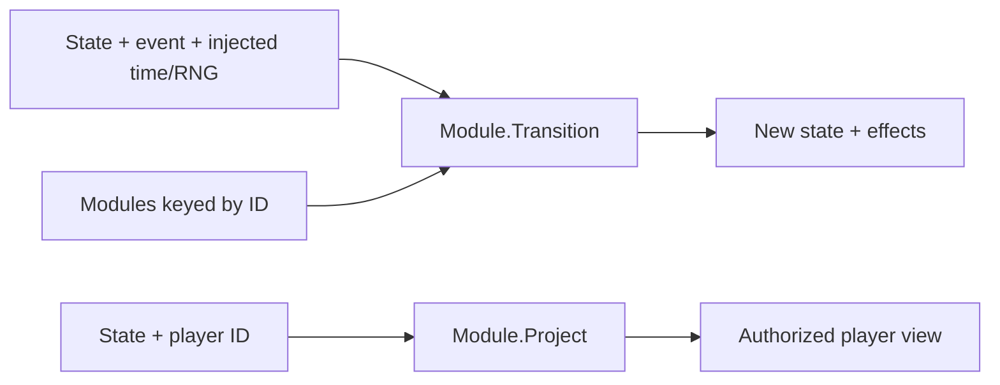
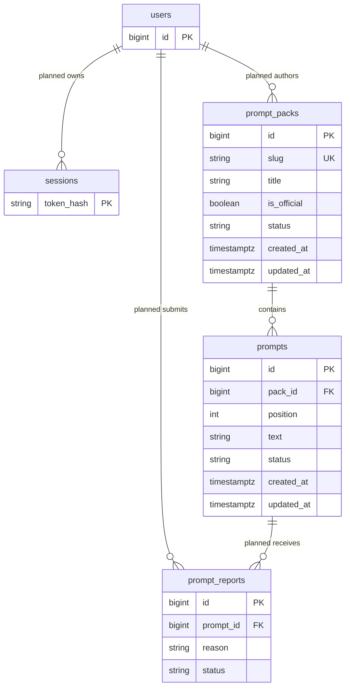

# Architecture

Implemented: platform/game PostgreSQL migrations and generated stores, original OG seed,
health/packs endpoints, create/join/reconnect HTTP intents, room actors/WebSockets and
a general Soc Party home/lobby with live membership and owner controls.
Health and content diagnostics live on /health, separate from room admission.
Zinger gameplay is implemented in memory; accounts, ads and deployment remain planned.

## System context

No host screen. Each participant eventually renders shared state and personal controls.
Browser URLs use localhost; service-to-service URLs use Docker DNS. The server-rendered
page fetches /healthz and /api/packs. The client lobby uses API_PUBLIC_URL and exact
ALLOWED_ORIGINS CORS checks; sockets also require an allowed origin.

## Room actor flow — implemented

The registry is the sole shared mutable room coordination point. Never perform network I/O
inside pure rules; effects are interpreted by the room runtime. Bound queues and writes.

## Join flow including AdGate — planned
```mermaid
sequenceDiagram
  participant P as Player
  participant A as Platform API
  participant G as AdGate provider
  participant R as Room actor
  P->>A: Join code + optional reconnect token
  A->>A: Validate origin, code, limits and capacity
  A->>G: Check consent / admission policy
  G-->>P: Mock first; ad if eligible later
  P->>A: Admission completion
  A->>R: Join intent
  R-->>P: Session token + authorized projection
```
M1 joins directly; M6 inserts AdGate, never during a round. Server validates admission;
client success claims are not authority. M1 guest reconnect policy is recorded in Decisions.

## Game module — implemented lifecycle

`backend/internal/games` contains the module registry/contract and Zinger contains the
deterministic engine, projections and adapter. Rooms resolve selected-pack prompts via
sqlc, inject time/RNG, interpret one scheduled deadline and broadcast authorized views.
Protocol convention: JSON `{type, id?, payload}`, snake_case types, camelCase fields.
Go protocol package is authoritative; frontend lib/protocol.ts mirrors it. Lobby message types are in protocol.go and mirrored in frontend/src/lib/protocol.ts.

## Content and planned account model
prompt_packs/prompts exist in wit_parade; users, sessions, prompt_reports and ownership FKs are planned.

Published official packs are exposed publicly. Prompt approval and account ownership arrive
in M3–M5; current constraints allow draft/published packs and pending/approved/rejected prompts.
Room/session reconnect tokens are separate from future account sessions. Live state is
actor-owned in memory; rooms/membership are persisted as audit records. Restart closes
old rooms; actors are not reconstructed. One API process only.

## Authorized MVP database split
`party`: legacy M0 content tables (retained, unused), rooms, room_players.
`wit_parade`: prompt_packs, prompts, game_sessions, game_players, rounds, matchups,
answers and votes. Goose histories and sqlc output packages are separate. The fixed game
database name is derived from DATABASE_URL by replacing its database path. Migration
bootstrap creates it, then migrates both databases. Go must validate cross-database IDs.
The prepared history schema remains unused by M2: games/results are intentionally
live-only. Pack/content queries supply initialization. OG has 29 original prompts;
Extended has three.

## Room game selection
The room actor stores `gameId`, persists it through sqlc, and broadcasts it in each
lobby projection. Only the owner may send `select_game` with `{gameId:"zinger"}`.
Unknown/unavailable games are rejected before persistence. The UI shows Zinger and
a disabled Coming soon option; guests see the same selector disabled. Selecting a
game chooses its registered module and the owner starts once eligible. The database constraint currently
allows only `zinger`; adding another game requires an explicit migration and module.

## M2 runtime design — implemented

The game specification is docs/games/zinger.md. M2 now includes DB prompt retrieval
from selected packs (formerly M3). The room obtains immutable approved prompts via
sqlc before start; the pure Zinger module deduplicates/samples with injected RNG.
The existing Module contract remains state + event + supplied time/RNG -> state +
effects, with per-player projection. No DB/network/clock reads inside the engine.

Room actors route authenticated game intents and presence events, own a single
reschedulable game deadline timer, and publish only the player's authorized snapshot.
The existing platform expiry cleanup remains separate from scheduled game transitions.
No new participants join after start. Fixed game rosters retain left players and
scores while platform credentials/owner transfer keep existing security behavior.
The room-side provider performs I/O outside the actor; admission/settings are
revalidated when the result is applied. Failed loads/insufficient prompts leave the
lobby intact. Game states/results are not persisted; room audit writes remain.

Clients use the existing tab socket and server snapshots. Countdown uses supplied
server time/deadlines, with local state only for current text and unsubmitted picks.
Frontend game views preserve PartiSocial branding and the shared toast/accessibility
conventions. Final voting has an absolute deadline and an all-done idle deadline;
the module schedules whichever applicable deadline comes first.
