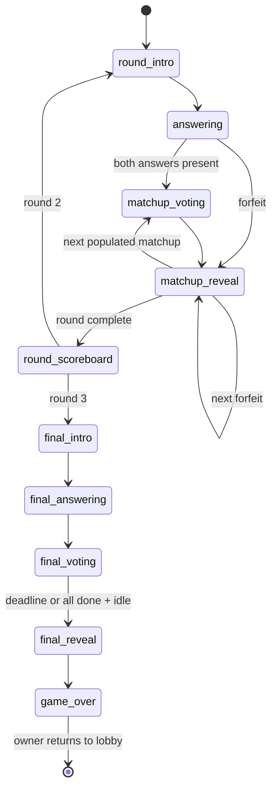

# Zinger rules — M2

Authorized 2026-11-10. Zinger is the existing original game ID, backend module and
player-facing name; the external prompt's “quiplash” paths map to Zinger.
Every player uses their own device; no shared host screen. Original prompts/copy only.

## Start and assignment

The connected owner starts with 3–8 connected players, fixed for the game. Existing
session tokens may reconnect within the platform's 60-second grace; new joins are
rejected during a game. Leave/kick/grace expiry revoke participation but retain the
player and their earned scores in the game. Returning to lobby keeps active members
and settings and resets game scores. Only the owner can return, at game over.

Load approved prompts from selected published official packs using sqlc outside the
engine. Deduplicate by ID and normalized text (trim, lowercase, collapse whitespace),
shuffle with supplied RNG, draw 2N+1. Reject insufficient content with
`not_enough_prompts`; owner sees advice to select more packs. Never repeat a prompt.
OG now contains 29 prompts; no new seed content is needed for this request.

For rounds 1 and 2, independently shuffle players into a cycle. Prompt k belongs to
players k and (k+1) mod N: two prompts each, two distinct authors per prompt, no pair
repeated within the round. Shuffle presentation order, avoiding consecutive authors
where possible (unavoidable for 3 players). Randomize anonymous answer order once.

## Answers, voting and points

One answering deadline covers both assignments. Strip control characters, trim and
validate 1–100 Unicode code points. Drafts may be empty; submission locks one answer.
The player UI shows one unanswered question at a time, advancing after server-confirmed
submission and showing a waiting state once all assigned answers are submitted.
Only the player sees their prompts/drafts during answering. End early when every
connected player submits all assigned answers; at phase end promote nonempty drafts.
Disconnect preserves editable drafts, with no immediate locking: reconnect before
answering ends can continue. Leaving also preserves drafts for phase-end promotion.
A decided matchup never reopens.

Show head-to-head matchups sequentially, anonymous during voting. N−2 non-authors
may select and change one vote until pressing Submit vote, which locks it. The server
preserves selections for reconnect and counts the latest unsubmitted selection at
the deadline. End early when all connected eligible voters submit.
The default voting scene reserves four additional seconds: a large prompt for
three seconds, then left and right answer entrances at 3 and 3.5 seconds. Voting
opens at four seconds with the full 20-second countdown; early intents are rejected.
Reveal scenes hide the countdown, pop vote counts at 0.5 seconds, show authors and
their selected avatars at 1.5 seconds, and insert awarded points at 2.5 seconds.
Answer, vote and point animations use their matching optional sound effects;
reduced motion removes spatial animation while retaining the scene order.
Reveal authors, vote counts and awarded points, never voter identities. Each vote
is 100 points in round 1, 150 in round 2. A unanimous win earns another 100 or 150,
only when all N−2 eligible players voted for that answer. Missing voters prevent the
bonus; ties retain individual vote points and have no bonus.

Exactly one empty answer skips voting and gives the other author N−2 votes plus
the unanimous bonus. Both empty skip voting with zero points. Always reveal both
answer slots with a clear empty placeholder. Show totals and round deltas after
each head-to-head round.

Round 3 uses one shared prompt, followed by anonymous final voting. Empty answers
have no final entry. Distribute exactly three votes among eligible answers, excluding
self: 3, 2–1, or 1–1–1. Each click adds one vote; the per-answer count shows the
distribution. Clear resets the selection and spans the action row after the first
pick; at three picks, a distinct Submit votes action shares half the row. Submission
locks the ballot. Unsubmitted final ballots do not count.
Players with no eligible answers are automatically finished with zero picks.
Once all connected players have submitted (or have no eligible answers), close after
the existing five-second reveal delay. Locked ballots cannot be revised; rejected
messages, heartbeats and unrelated messages do not reset the delay. A reconnect
that introduces an unfinished voter cancels the idle window. The absolute 30-second
deadline always wins. Each pick awards 200; no bonus. Reveal ranked answers, authors,
counts and points; then final totals/podium with shared competition ranks on ties.

If fewer than two connected players remain continuously for the 60-second reconnect
grace, end with current awarded scores. All phase progression is server-owned.

## State machine

Any active phase can end at game_over on insufficient connected players past grace.
Every timed phase exposes a server deadline; ticks are scheduled, never polled by
the game. Final voting also exposes its effective idle-close deadline when armed.

## Tunables

All game defaults live in zinger.Config, overridable in tests. Integer scoring:
`votes * BasePoints * multiplierPermille / 1000`, plus scaled bonus where eligible.

| Setting | Default |
| --- | --- |
| Players | 3–8 |
| Answer length | 1–100 code points after sanitation |
| Base vote points / unanimous bonus base | 100 / 100 |
| Multipliers, per mille | 1000 / 1500 / 2000 |
| Maximum final picks | 3 |
| Round intro (including final) | 4 seconds |
| Answering rounds 1/2 | 90 seconds |
| Head-to-head voting / reveal | 20 / 7 seconds |
| Round scoreboard | 8 seconds |
| Final answering / voting / reveal | 60 / 30 / 12 seconds |
| Final voting idle close after all done | 5 seconds |
| Insufficient-player grace | 60 seconds (platform grace) |

No game/result persistence, accounts, ads, sound, spectators or infrastructure.
